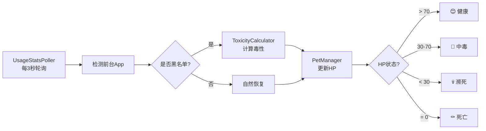

# Fragile Focus (玻璃心) 🤢💔

<p align="center">
  
  
  
  
  
</p>

> **基于"损失厌恶"心理的注意力管理工具** - 让虚拟宠物的生死守护你的专注力

## ✨ 核心理念

人们对**失去**的恐惧远大于获得的快乐。Fragile Focus 利用这一心理学原理，通过一只脆弱的虚拟宠物来监督你的手机使用习惯：

- 📱 **实时监控**: 后台监控你正在使用的 App
- ☠️ **毒性系统**: 抖音、B 站等娱乐 App 会让宠物中毒掉血
- 💚 **回血机制**: 墨墨背单词、微信读书等学习 App 会帮助宠物回血
- 💀 **真实死亡**: 宠物 HP 归零后会真正死亡，记录进"墓地"
- 🪦 **公开处刑**: 死因会被记录（"死于抖音"），激励你改变习惯

## 🎯 产品特色

### 1. 精准监控引擎

基于 Android `UsageStatsManager` API，每 3 秒轮询一次前台应用，实现近乎实时的监控反馈。

### 2. 智能毒性计算

内置三级分类系统：

- **白名单 ⚪**: 学习类 App（墨墨背单词、微信读书）→ 回血 +2 HP/s
- **灰名单 🔘**: 工具类 App（微信、钉钉）→ 缓慢自然衰减 -0.5 HP/s
- **黑名单 ⚫**: 娱乐类 App（抖音、B 站、微博）→ 急速扣血 -5 HP/s

### 3. 状态机宠物系统

宠物拥有 4 种状态，每种状态都有独特的视觉动画：

- 😊 **健康** (HP > 70): 缓慢跳动
- 🤢 **中毒** (HP 30-70 + 黑名单 App): 震动抖动
- 💀 **濒死** (HP < 30): 闪烁警告
- ⚰️ **死亡** (HP = 0): 倒下淡出

### 4. 后台保活机制

- ✅ 前台服务 (Foreground Service) 保证监控不被杀死
- ✅ 开机自启 (BootReceiver) 系统重启后自动开始守护
- ⚠️ WorkManager 定期检查服务存活状态

## 🏗️ 技术架构

```
FragileFocus (MVVM + Clean Architecture)
│
├── Presentation Layer (Jetpack Compose UI)
│   ├── MainActivity
│   ├── PermissionScreen (引导用户授权)
│   ├── MainScreen (宠物主界面)
│   └── PetVisualization (宠物动画组件)
│
├── Domain Layer (业务逻辑)
│   ├── PetManager (状态机 + HP监控)
│   ├── PetState (4种状态: Healthy/Poisoned/Critical/Dead)
│   └── ToxicityRule (毒性规则定义)
│
├── Infrastructure Layer (底层设施)
│   ├── MonitorService (前台服务)
│   ├── UsageStatsPoller (应用监控轮询器)
│   ├── ToxicityCalculator (毒性计算引擎)
│   └── BootReceiver (开机自启)
│
└── Data Layer (未实现 - 后续扩展)
    ├── Room (本地数据库)
    └── Supabase (云端墓地同步)
```

## 🚀 快速开始

### 环境要求

- **Android Studio**: Hedgehog (2023.1.1) 或更高版本
- **Android SDK**: API Level 26+ (Android 8.0)
- **测试设备**: Android 8.0+ 真机或模拟器

### 安装步骤

1. **克隆仓库**

   ```bash
   git clone https://github.com/yourusername/fragile-focus.git
   cd FragileFocus
   ```

2. **用 Android Studio 打开项目**

   ```
   File -> Open -> 选择 FragileFocus 目录
   ```

3. **等待 Gradle 同步完成**
4. **运行应用**
   - 连接 Android 设备或启动模拟器
   - 点击 Run 按钮（绿色三角形）

### 首次使用

1. **授予权限**: 首次启动会引导你跳转到系统设置授予 `使用情况访问权限`
2. **查看宠物**: 返回 App 后即可看到宠物（默认健康状态 😊）
3. **测试功能**: 使用底部的"调试控制"按钮测试不同状态的视觉效果
4. **真实监控**: 打开抖音/B 站等黑名单 App，观察宠物状态变化

## 🎮 使用说明

### 监控流程



### 调试控制（MVP 版本）

为了方便测试，主界面底部提供了 4 个调试按钮：

- **健康**: 立即将宠物状态设为健康（HP=100）
- **中毒**: 模拟使用抖音导致中毒（HP=50）
- **濒死**: 模拟长时间使用有毒 App（HP=20）
- **死亡**: 直接触发死亡状态（HP=0）

> 💡 在真实使用场景中，这些按钮应该被移除，仅保留自然的监控机制。

## 📋 开发计划

- [x] ✅ 核心监控引擎（UsageStatsPoller）
- [x] ✅ 宠物状态机（PetManager）
- [x] ✅ Jetpack Compose UI（精美动画）
- [x] ✅ 前台服务保活（MonitorService）
- [ ] 🚧 Room 本地数据库（墓地记录持久化）
- [ ] 🚧 Supabase 云端同步（排行榜功能）
- [ ] 📝 LLM 墓志铭生成（DeepSeek API）
- [ ] 📝 设置界面（自定义毒性规则）
- [ ] 📝 Widget 桌面小组件（显示宠物状态）
- [ ] 📝 Lottie 动画替换 Emoji

## 🐛 已知限制（MVP 版本）

1. **依赖注入未实现**: 当前使用手动实例化，未集成 Hilt/Dagger
2. **数据不持久化**: 杀掉 App 进程后宠物状态会重置
3. **Supabase 未启用**: 墓地同步功能暂未实现
4. **厂商适配**: 部分手机（小米、华为）可能需要手动加白名单

## 🤝 贡献指南

欢迎提交 Issue 和 PR！

## 📄 开源协议

MIT License - 详见 [LICENSE](LICENSE) 文件

---

<p align="center">
  用 💜 制作 | 让专注回归本质
</p>
